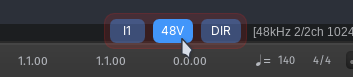
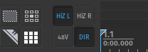

# Reaper things

## MiniFuse Control
A Lua-script for Reaper to control the Arturia MiniFuse 1 and 2 audio cards, a wrapper for [minifuse-cli](https://github.com/zxsleebu/minifuse-cli) (Windows) and [mf-cli](https://github.com/nolight132/mf-cli) (Linux). This script will not work unless one of these applications is installed, depending on your operating system.



### Install
Download the `MiniFuse_Control` directory and place it in the `Scripts` directory in the Reaper settings directory. The directory includes the original `MiniFuse_Control.lua` panel, the four independent button scripts, their shared `MiniFuse_Control_Buttons.lua` module, and `MiniFuse_Control.ini`.

### Independent toolbar buttons

If you prefer Reaper's own toolbar buttons instead of the ImGui panel, load the actions you want from `MiniFuse_Control_48V.lua`, `MiniFuse_Control_DIR.lua`, `MiniFuse_Control_I1.lua`, and `MiniFuse_Control_I2.lua` with `Actions > Show action list... > New action > Load ReaScript...`. Each script is an independent toggle action; add it to any toolbar from the Action List. The toolbar toggle state tracks the last command issued by that action.



Keep all the files together in the `MiniFuse_Control` directory so the action scripts can load their shared module and configuration.

### Configuration

Both the ImGui panel and the independent toolbar actions use `MiniFuse_Control.ini` for the operating system and MiniFuse CLI commands. The toolbar actions also honor the `button_*` enable flags below. Button order and appearance settings apply only to the ImGui panel.

These lines allow you to specify the panel's button order and disable unnecessary buttons:
```
button_order=I1,I2,48V,DIR
button_48V=1
button_DIR=1
button_I1=1
button_I2=0
```

Since I'm not a programmer, and this script is a product of vibe coding using ChatGPT and Copilot, I don't quite understand what's going on and I apologize for that. Some lines for customizing the appearance work, but I still couldn't get some things to work. If you understand this code and know how to fix it, you're welcome. Somehow it works for now and I have this little panel I wanted, so you can use it too.

### Linux
Just install [mf-cli](https://github.com/nolight132/mf-cli).

Currently `mf-cli` supports only one channel, so you can't switch Hi-Z on the second channel on MiniFuse 2. You can disable extra button through a configuration file if you don't need it.

If you want, for now you can use [my fork](https://github.com/Omega9/mf-cli) of `mf-cli`, but you have to compile and install it manually.

### Windows
1. Download [Arturia MiniFuse CLI Control](https://github.com/zxsleebu/minifuse-cli)
2. Here you must specify the path to `python.exe` to launch the `minifuse-cli` and the path to the `minifuse-cli` itself:
```
python=C:\Python314\python.exe
script=D:\Tools\minifuse-cli\main.py
```

### Run
In Reaper `Actions > Show action list... > New action > Load ReaScript...` and load `MiniFuse_Control.lua`.

To run the script automatically when starting Reaper, add the following line to `/REAPER/Scripts/__startup.lua`, where `_RSf314d93495085a9b2961efc1be2c6796844e49bf` is the script id that you will find in the Action list after the first launch:
```lua
-- Run Arturia MiniFuse Panel
reaper.Main_OnCommand(reaper.NamedCommandLookup("_RSf314d93495085a9b2961efc1be2c6796844e49bf"), -1)
```
